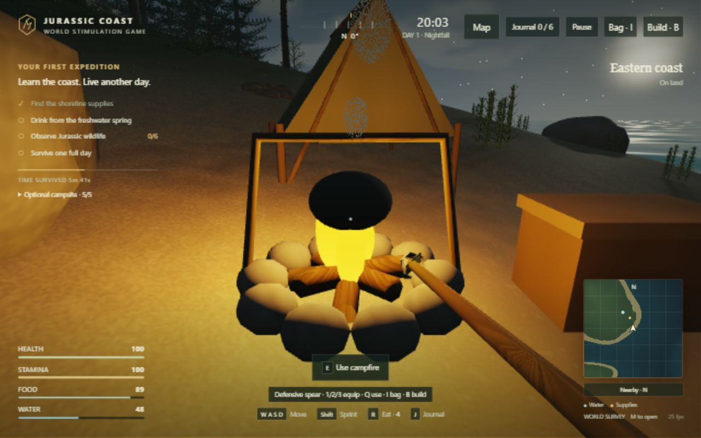

# Gathering and camping

Camping is optional. The existing six-observation, water, supplies and full-day objectives remain unchanged. Death ends the expedition; resting does not respawn the player.

## Getting started

Face a branch bundle, loose stones or fallen fiber and press **E**. Starter bundles occur within 40 metres of spawn, away from the starting predators. Nodes have finite yields and stay depleted after reload. Materials must fit in full before collection. Standing trees cannot be felled.

Open **I** for inventory and crafting. Crafting a tool equips it. Use **1 / 2 / 3** for hands / hatchet / spear and **Q** to use the equipped tool. The hatchet harvests larger bundles beside fallen logs. The spear is defensive: a successful aimed thrust within four metres costs 20 stamina, interrupts a land predator's bite and makes it hesitate for two seconds. Thrusts have a 1.2-second cooldown; an interrupted predator resists another interruption for eight seconds. There are no kills, meat drops or tool durability.

| Recipe | Cost | Result |
| --- | --- | --- |
| Stone hatchet | 2 wood, 2 stone, 1 fiber | Harvest fallen timber |
| Spear | 3 wood, 1 stone, 2 fiber | Defensive thrust |
| Tent | 8 wood, 8 fiber | Rest and save |
| Campfire | 4 wood, 6 stone | Light and cooking |
| Chest | 6 wood, 2 fiber | 100 units of storage |
| Cooked meal | 1 cooking provision | Restore 55 hunger |

Backpack limits are 40 wood, 30 stone, 40 fiber, 10 provisions and 10 meals. Existing rations remain a separate supply, capped at 1,000. Each supply cache gives its original two rations plus one cooking provision, retaining its own five-minute simulation cooldown. A collection requires room for both food types. **R** still eats a ration; eat cooked meals through **I**.

## Building and storage

Press **B**, select a structure, then move around to position its live preview. **T** rotates 15 degrees; **Z / X** move the preview closer / farther; **E** places it; **Esc** cancels. Equivalent on-screen controls are available. A green preview is valid; red previews explain the failure. Materials are charged only on successful placement.

Build one tent first. One fire and one chest may stand within 12 metres of it, with the fire at least three metres from the tent. Water, slopes above 15 degrees, obstacles, starting wildlife clearings, protected travel corridors and spring/cache access zones are excluded. Rotate or move the preview to find suitable ground. Camp collision bounds are rebuilt together with the original world for both player and wildlife movement.

Face a structure and press **E** for its controls. Tent rest saves immediately and restores stamina at 20 per second, twice normal idle recovery. Time, hunger, thirst and wildlife continue; moving or pressing E stops rest. There is no time skip or protection from attacks.

The chest holds 100 total material/food units. Choose one, five or all units and explicitly deposit or withdraw. Failed transfers change neither inventory. Pack only empty structures when the complete original construction refund fits in the backpack. The tent must be packed last. A fire must be extinguished with no cooking job, meal or fuel remaining. Reclaim whole unused fuel logs first; the separate clear-embers action discards any fractional residue. Stored items and ready meals cannot be silently discarded by packing.

## Fire and cooking

Add wood through the fire controls, then light it. Each wood supplies 60 seconds of simulation fuel, up to 600 seconds. Cooking consumes one provision and takes ten simulation seconds, requiring at least ten seconds of fuel. Only one meal may cook or await collection. Collect it when ready, then eat through inventory. Close menus to let cooking advance.

Menus pause simulation. Placement, gathering, rest and climbing remain live. Closing the game also stops fuel and cooking timers; there is no offline progress. The fire has local warm light, animated flames/smoke and procedural crackling audio. It neither spreads nor repels wildlife.

## Tree climbing

Selected conifers have visible low branches and a fixed route to a perch about six metres above ground. Face the entry and press **E**, then use **W / S** to ascend / descend and mouse or drag to look. Ascending costs eight stamina per second. Exhaustion forces controlled descent; the perch restores stamina. **E** also starts controlled descent. Walking, jumping off, tools and building are disabled on the route. Land predators may watch below but cannot bite an unreachable perched player.

## Saves and development

Version-two saves retain materials, tools, depleted node IDs, camp transforms, storage, fuel and cooking progress alongside existing survival and observation data. Version-one saves migrate to empty new inventories and no camp. The original save key is retained. Loading a climbing save puts the player safely at that tree's ground entry. Rest and placement previews do not resume on load. New expeditions clear all additions.

`camping.js` owns transactions, targeting, placement, climbing and save validation. `adventure-world.js` owns deterministic nodes, climbing routes and reserved dynamic instances. `camping-ui.js` owns paused inventory/build/structure panels and live prompts. Reserved instances are toggled rather than rebuilding the forest. Release HTML excludes development travel/time fixtures; development saves use a separate slot.

Run `node --test source/tests/simulation.test.mjs`, `node source/build-jurassic.mjs` and `node source/build-jurassic.mjs --dev` from the repository root. See [validation](VALIDATION.md) for the exercised loop and remaining playtests.

## Screenshots

[Inventory](screenshots/inventory.jpg) · [Placement](screenshots/placement.jpg) · [Storage](screenshots/storage.jpg) · [Tree perch](screenshots/tree-perch.jpg)
