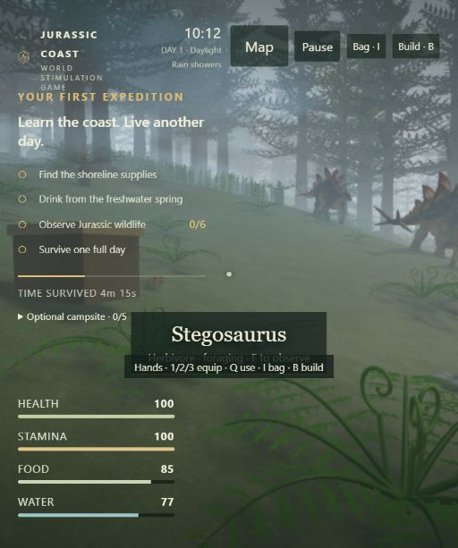

# Changing coastal weather

Weather changes automatically during exploration. Clear skies give way to cloud cover, a passing shower, easing rain, coastal mist and clearing skies. Transitions blend over 28 simulation seconds instead of switching instantly. The compressed front lasts ten simulation minutes; shower intensity varies between fronts and wind direction changes gradually. The first expedition starts clear, with cloud buildup after about 110 seconds.

Clouds change the sky, sunlight and reflections. Rain adds wind-slanted, depth-tested world-space streaks, rain/wind audio and small water-surface ripples. Foliage movement follows wind strength; terrain, foliage and rock surfaces darken and become less rough as the front passes. Mist reduces distant visibility. The clock display names the current weather, including on narrow screens. No extra controls are needed.

Weather follows saved expedition time. Pausing, reading inventory/journal/map menus or closing the game stops its progression; reloading resumes the same front. A new expedition starts clear. Existing version-one and version-two saves require no additional migration fields. Death/victory freezes the simulation as before.

Standing beneath the tent roof suppresses nearby visible drops and muffles rain audio. Underwater views exclude rain streaks and weather audio. Rain does not damage the player, extinguish campfires, spoil food or change predator rules. Existing survival costs and victory conditions remain unchanged.

Implementation: `source/jurassic/weather.js` derives bounded weather parameters from elapsed simulation time and calculates rotated A-frame shelter. The renderer extends the uniform buffer from 64 to 76 floats, preserving existing fire/light offsets and the vertex/instance formats. A fixed pool of 640 procedural streaks adds one draw only during exposed rain; no forest rebuild or per-drop CPU simulation is required. Scene and shadow foliage share wind deformation. All weather assets and audio are authored in code under MIT.

## Validation and limits

All 61 automated checks pass. Four new tests cover bounded continuous phase transitions (including front boundaries), deterministic save/reload/new-expedition behavior, rotated tent roof shelter and uniform-buffer compatibility. All 57 prior survival/world tests remain passing.

Chromium WebGPU compiled the revised scene, water, sky and rain shaders. Development fixture views showed clear daylight, rain and mist; a night shower was also inspected. A paused shower saved and reloaded at the identical elapsed time (4m 17s) with the same weather label. The final standalone release reached the expedition menu without reported warning/error logs. The weather label was verified in the narrow browser layout. These were targeted fixture checks, not an uninterrupted weather-cycle playthrough, an acoustic listening evaluation or a device benchmark. Tent shelter is covered by geometry tests; a complete walk-in shelter playtest remains useful.

This is a stylized coastal weather front, not a climate model or a reconstruction of exact Jurassic weather. It has no snow, lightning, weather damage, physical water accumulation or terrain-wide rain collision simulation. Depth testing hides streaks behind visible geometry; nearby drops are suppressed while sheltered, so precipitation outside an open tent is approximated. Physical mobile testing and sustained performance measurement remain separate.

[Clear skies](screenshots/weather-clear.jpg) · [Coastal mist](screenshots/weather-mist.jpg)
